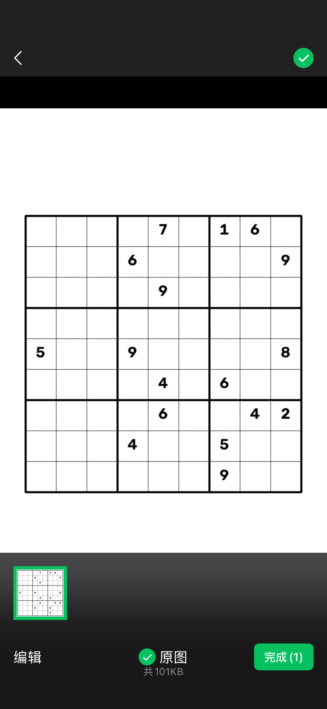
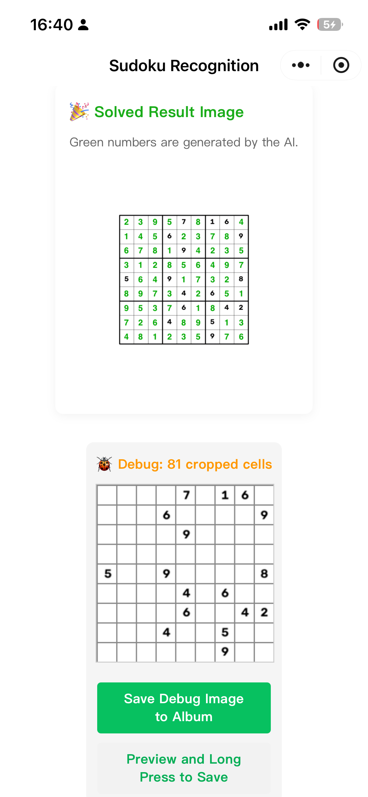

# sudokuwetmini

This project demonstrates:
- How to use an AI model in ONNX format within a WeChat Mini Program to recognize digits from a Sudoku puzzle photo and provide the solution.

## Mini Program Demo

**Figure 1:** When you open the Mini Program, if everything is working properly, it should display "AI Model: ✅ Ready".

**Figure 2:** Click the green "Take Photo / Select Sudoku Image" button, then select a photo of the Sudoku puzzle (black digits on a white background).

**Figure 3:** If the Sudoku puzzle is solvable, the solved result image will be displayed.

## How it Works

- The code uses an AI model in ONNX format designed to recognize digits 1 to 9 (refer to another project: [Pi4B ONNX Sudoku GitHub Repository](https://github.com/leputz/Pi4B_ONNX_Sudoku)).
- The input photo of the Sudoku puzzle undergoes preprocessing, which includes detecting the boundary and evenly splitting it into a 9x9 = 81 grid of cell images, each potentially containing a digit.
- Each cell image is fed into the AI model to recognize all digits or blank spaces in the Sudoku puzzle.
- A backtracking search is used to find the solution for the Sudoku puzzle.
